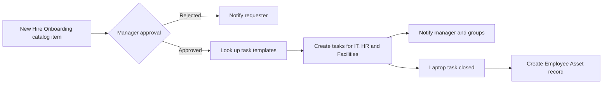
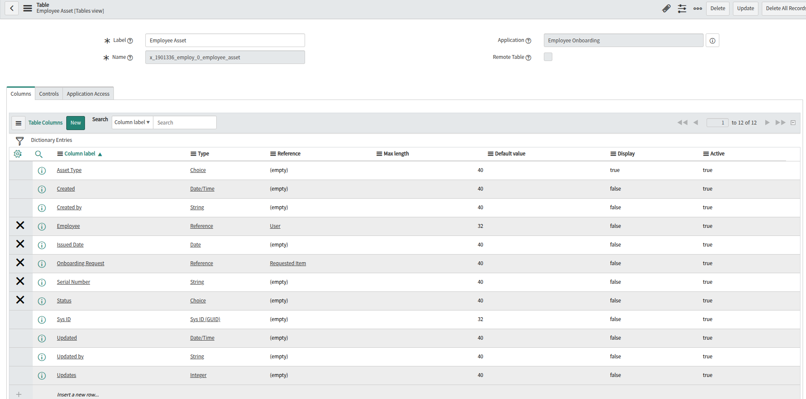
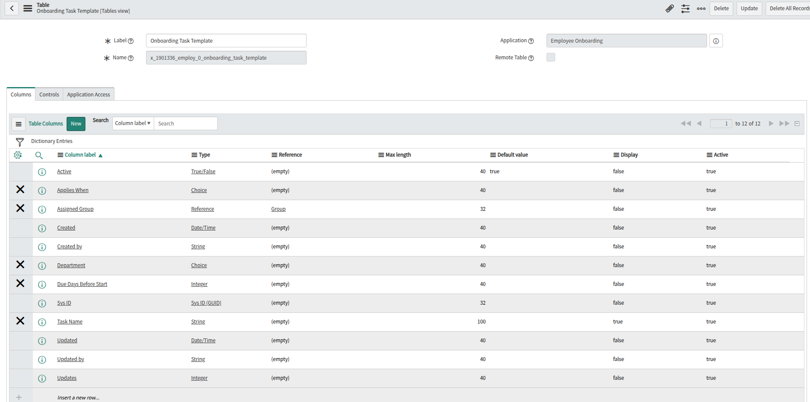
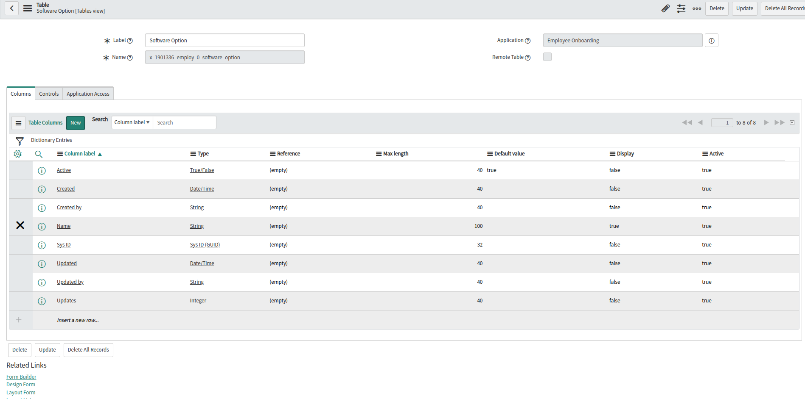
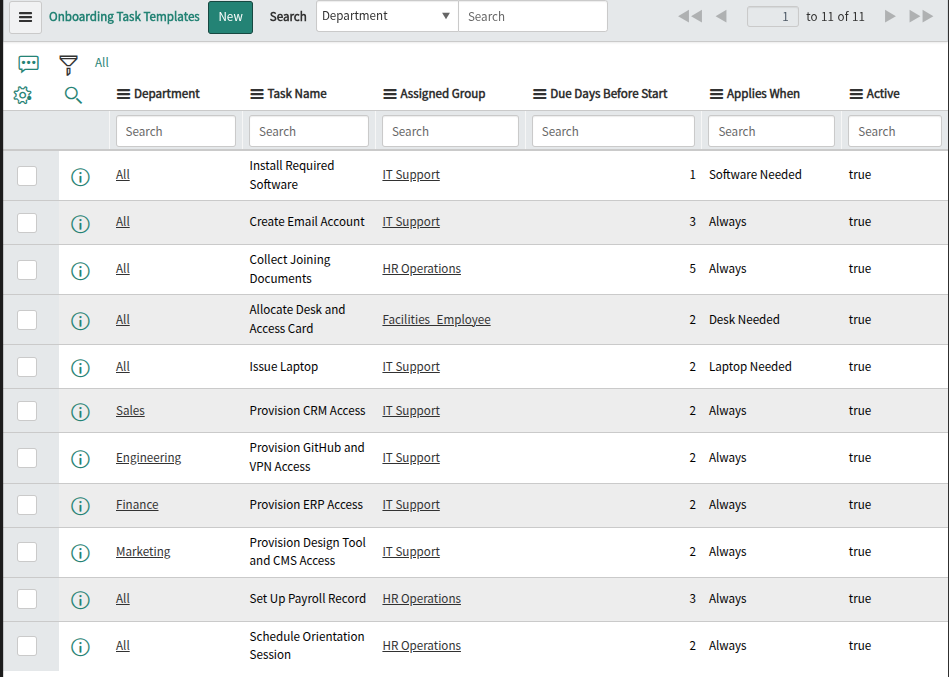

<div align="center">

# Employee Onboarding Automation

**A scoped ServiceNow application that turns one catalog request into a complete, tracked new-hire onboarding.**


</div>

---

## Overview

Onboarding a new hire usually means chasing IT, HR and Facilities by email. This application replaces that with a single **New Hire Onboarding** catalog item. One request captures everything about the hire, gets manager approval, and automatically creates the right tasks for the right teams, with due dates worked out from the start date.

Built as a self-directed project on a ServiceNow Personal Developer Instance (PDI) to practise real ITSM patterns: scoped applications, Service Catalog, Flow Designer, scripting, ACLs and reporting.

## Project Status

| Sprint | Dates | Focus | Status |
|---|---|---|---|
| 1 | Oct 10 - 11, 2026 | Foundation and catalog item | In progress (data model and seed data done) |
| 2 | Oct 12 - 14, 2026 | Automation with Flow Designer | Planned |
| 3 | Oct 15 - 16, 2026 | Security, reporting and publish | Planned |

Full task list: [docs/sprint-plan.md](docs/sprint-plan.md) | History: [CHANGELOG.md](CHANGELOG.md)

## How It Works



1. The requester submits the catalog item with the hire's department, start date, manager and equipment needs.
2. The hiring manager approves or rejects the request.
3. On approval, a flow reads the **Onboarding Task Template** table and creates one catalog task per matching template, assigned to the right group.
4. Due dates are calculated from the start date and each template's lead time.
5. Closing the laptop task records the device in **Employee Asset**.

## Data Model

Scope: `x_1901336_employ_0`

| Table | Purpose |
|---|---|
| **Employee Asset** | Equipment issued to a new hire (asset type, serial number, status, linked request) |
| **Onboarding Task Template** | Rules that drive task creation: department, task, assigned group, lead time, and when it applies |
| **Software Option** | Software choices shown to the requester in the catalog form |

Field-level details and the entity diagram are in [docs/data-model.md](docs/data-model.md).

## Tech Stack

ServiceNow PDI | Scoped application (Studio) | Service Catalog | Catalog UI Policies and Client Scripts | Flow Designer | Script Includes | Business Rules | Scheduled Jobs | ACLs and Roles | Reports and Dashboards | Update Sets

## Repository Structure

```
servicenow-employee-onboarding/
├── README.md
├── CHANGELOG.md
├── LICENSE
├── docs/
│   ├── data-model.md        Tables, fields, choice values, relationships
│   ├── sprint-plan.md       Sprint-by-sprint task checklist
│   └── screenshots/         Build screenshots, added each sprint
├── seed-data/
│   ├── onboarding_task_templates.csv
│   └── software_options.csv
├── scripts/
│   └── client-scripts/
│       └── validate-start-date.js
└── update-sets/             Exported per sprint (sprint-1.xml, ...)
```

## Getting Started

1. Get a free PDI from [developer.servicenow.com](https://developer.servicenow.com).
2. In the PDI, go to **System Update Sets > Retrieved Update Sets > Import Update Set from XML**, import each file from [update-sets/](update-sets/) in sprint order, then **Preview** and **Commit**.
3. Create the groups **IT Support**, **HR Operations** and **Facilities_Employee**, and add yourself as a member.
4. Load the [seed data](seed-data/). Update sets carry configuration only, not records.
5. Open the **New Hire Onboarding** item in the Service Portal and submit a request.

More detail on exporting and importing: [update-sets/README.md](update-sets/README.md).

## Seed Data

| File | Rows | Contents |
|---|---|---|
| [onboarding_task_templates.csv](seed-data/onboarding_task_templates.csv) | 11 | Onboarding tasks by department and condition |
| [software_options.csv](seed-data/software_options.csv) | 6 | Software offered in the catalog form |

## Roadmap

- [x] Scoped application and data model (Sprint 1)
- [x] Seed data for task templates and software options (Sprint 1)
- [ ] Catalog item with variables, UI policies and date validation (Sprint 1)
- [ ] Approval, task creation and notifications in Flow Designer (Sprint 2)
- [ ] Script Include for due dates and asset record creation (Sprint 2)
- [ ] Overdue reminders, roles and ACLs, reports and dashboard (Sprint 3)
- [ ] Offboarding catalog item (stretch)
- [ ] Incident management with SLA and AI-assisted routing (second project)

## Screenshots

### Sprint 1: data model and seed data

| Employee Asset | Onboarding Task Template |
|---|---|
|  |  |

| Software Option | Seeded task templates |
|---|---|
|  |  |

More are added to [docs/screenshots/](docs/screenshots/) as each sprint completes: catalog form, flow canvas, generated tasks and the dashboard.

## Author

**Aditya Joshi**, Pune, India

## License

Released under the [MIT License](LICENSE).
