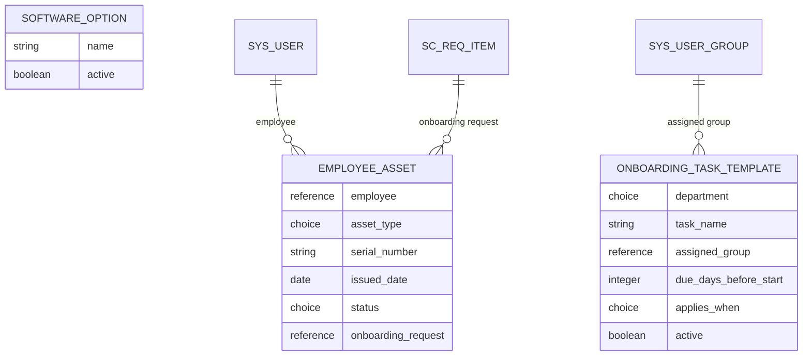

# Data Model

Application scope: `x_1901336_employ_0`

## Entity diagram

`Software Option` has no foreign keys. It feeds the **Software** List Collector variable on the catalog item.

## Tables

### Employee Asset (`x_1901336_employ_0_employee_asset`)

Display column: **Asset Type**

| Column | Type | Notes |
|---|---|---|
| Employee | Reference > User | The new hire |
| Asset Type | Choice | `laptop`, `monitor`, `access_card`, `software_license` |
| Serial Number | String (40) | |
| Issued Date | Date | |
| Status | Choice | `requested`, `issued`, `returned` |
| Onboarding Request | Reference > Requested Item | Links the asset to the originating request |

### Onboarding Task Template (`x_1901336_employ_0_onboarding_task_template`)

Display column: **Task Name**

| Column | Type | Notes |
|---|---|---|
| Department | Choice | `all`, `engineering`, `hr`, `finance`, `sales`, `marketing` |
| Task Name | String (100) | |
| Assigned Group | Reference > Group | Group that receives the task |
| Due Days Before Start | Integer | Lead time before the hire's start date |
| Applies When | Choice | `always`, `laptop_needed`, `software_needed`, `desk_needed` |
| Active | True/False | Default true |

A template row applies to a request when it is active, its department is `all` or matches the requested department, and its **Applies When** condition is met by the answers on the catalog form.

### Software Option (`x_1901336_employ_0_software_option`)

Display column: **Name**

| Column | Type | Notes |
|---|---|---|
| Name | String (100) | |
| Active | True/False | Default true |

## Catalog variables (New Hire Onboarding)

| Variable | Type | Mandatory |
|---|---|---|
| employee_name | Single Line Text | Yes |
| department | Select Box | Yes |
| job_title | Single Line Text | Yes |
| start_date | Date | Yes |
| hiring_manager | Reference > User | Yes |
| needs_laptop | Yes/No | No |
| laptop_type | Select Box | No, shown when `needs_laptop` is true |
| needs_software | Yes/No | No |
| software_list | List Collector > Software Option | No, shown when `needs_software` is true |
| needs_desk | Yes/No | No |
| office_location | Select Box | No, shown when `needs_desk` is true |

### Behaviour

- **Department** reads its choices from the Department field on Onboarding Task Template, so the form and the task rules share one source. The `all` choice means "every department" on the template table, so it is removed on load ([hide-all-department-option.js](../scripts/client-scripts/hide-all-department-option.js)) and rejected on submit ([reject-all-department.js](../scripts/client-scripts/reject-all-department.js)).
- **Start Date** rejects dates in the past ([validate-start-date.js](../scripts/client-scripts/validate-start-date.js)).
- **Laptop Type, Software List and Office Location** are shown and required by three Catalog UI Policies with Reverse if false, so they hide again when the answer goes back to No.
