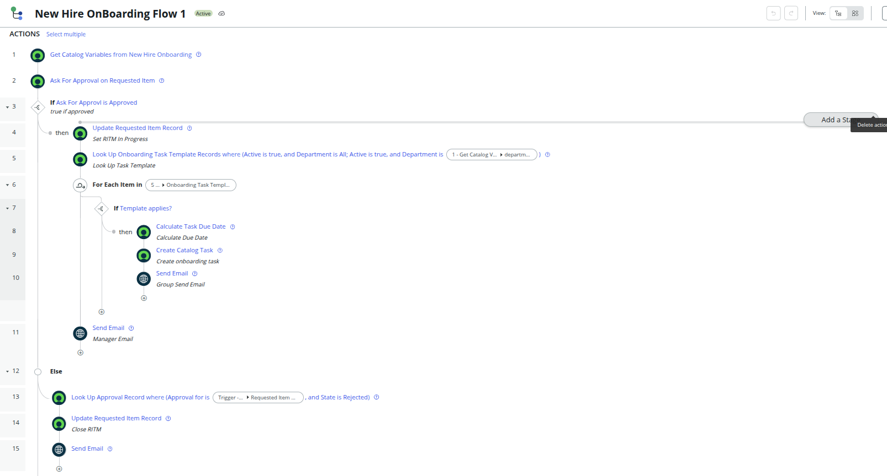
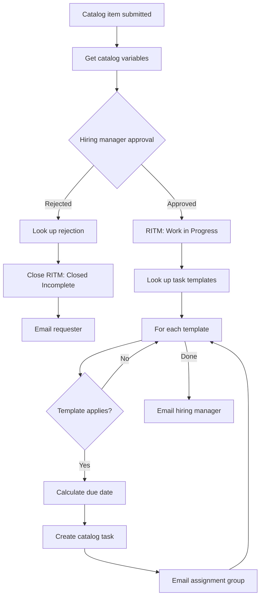
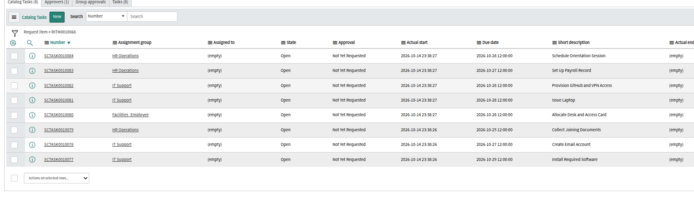
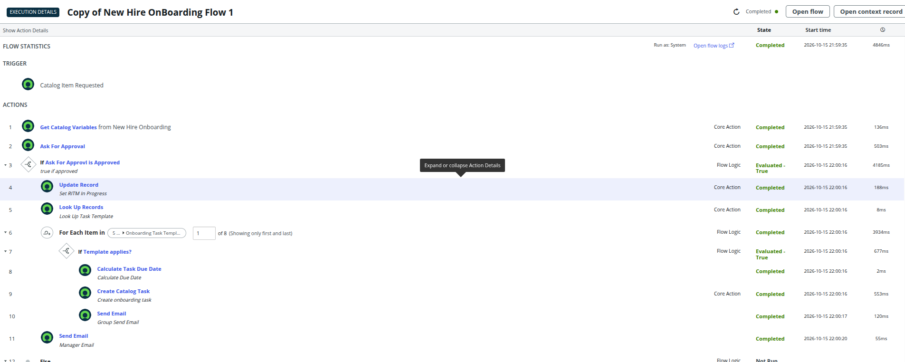
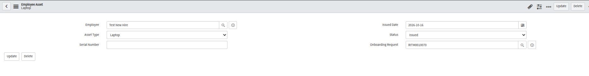
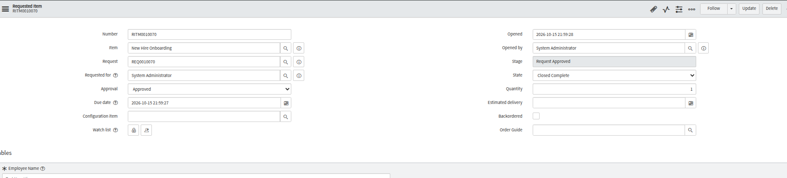
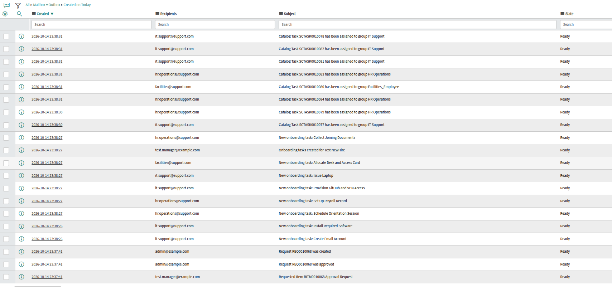

# Flow and Automation

Everything that happens after the request is submitted. The flow is built in Flow Designer (Workflow Studio), runs as System, and lives in the Employee Onboarding application.

## Trigger and steps

**Trigger:** Service Catalog, item **New Hire Onboarding**.

| # | Step | What it does |
|---|---|---|
| 1 | Get Catalog Variables | Reads the 11 variables from the request |
| 2 | Ask For Approval | Approval from the hiring manager on the requested item |
| 3 | If approved | Branches on the approval state |
| 4 | Update Record | Sets the RITM to Work in Progress |
| 5 | Look Up Records | Active Onboarding Task Template rows where Department is All, or the requested department |
| 6 | For Each | Loops over the matching templates |
| 7 | If "Template applies?" | Applies When is Always, or Laptop / Software / Desk Needed with the matching Yes/No answer true |
| 8 | Calculate Task Due Date | Custom action: start date minus the template's lead time |
| 9 | Create Catalog Task | Short description from Task Name, assignment group from Assigned Group, due date from step 8 |
| 10 | Send Email | Tells the task's assignment group |
| 11 | Send Email | One email to the hiring manager after the loop |
| 12 to 15 | Else (rejected) | Looks up the rejection, closes the RITM as Closed Incomplete, and emails the requester with the manager's comments |

## Pieces outside the flow

| Piece | Type | Role |
|---|---|---|
| [OnboardingUtils](../scripts/script-includes/OnboardingUtils.js) | Script Include | `getDueDate(startDate, daysBefore)`. Returns noon on the start date minus the lead time, or now if that date has already passed |
| [Calculate Task Due Date](../scripts/flow-actions/calculate-task-due-date.js) | Flow action | Flow Designer cannot call a Script Include directly, so this wraps it |
| [Create Employee Asset](../scripts/business-rules/create-employee-asset.js) | Business Rule on Catalog Task | When "Issue Laptop" closes, creates an Employee Asset (Laptop, Issued, today), linked to the request. Skips if one already exists |
| [Close RITM](../scripts/business-rules/close-ritm-on-last-task.js) | Business Rule on Catalog Task | Closes the request when its last open task closes |

The Employee reference on the asset is filled when a user with the same name as the form's Employee Name exists. New hires often have no account yet (creating one is itself a task), so otherwise it stays blank and the record is still linked to the request.

## Test results

| Scenario | Result |
|---|---|
| Engineering, laptop, software and desk all Yes | 8 tasks |
| Engineering, all No | 5 tasks, with no laptop, software or desk task |
| Start date 2026-10-30 | Due dates 3 to 5 days earlier per template (below) |
| Close "Issue Laptop" | One Employee Asset record; closing it again creates no second record |
| Close the last open task | RITM moves to Closed Complete; stays In Progress until then |
| Manager rejects | RITM closed as Closed Incomplete, requester emailed |

Due dates for a request with start date 2026-10-30, all answers Yes:

| Task | Assignment group | Due |
|---|---|---|
| Collect Joining Documents | HR Operations | Oct 25 |
| Create Email Account | IT Support | Oct 27 |
| Set Up Payroll Record | HR Operations | Oct 27 |
| Schedule Orientation Session | HR Operations | Oct 28 |
| Issue Laptop | IT Support | Oct 28 |
| Allocate Desk and Access Card | Facilities_Employee | Oct 28 |
| Provision GitHub and VPN Access | IT Support | Oct 28 |
| Install Required Software | IT Support | Oct 29 |

## Notes

- **Approver role:** the hiring manager needs the `approver_user` role to see **My Approvals** in the menu. Role assignments are data, so they are not in the update sets.
- **Group emails:** assignment groups need an email address, or the Send Email step fails with "no recipients". ServiceNow's own assignment notification also fires, so a group receives two emails per task. Remove step 10 from the flow if only the platform one is wanted.
- **Emails on a PDI** stay in the outbox with state Ready, since a Personal Developer Instance has no mail server.

